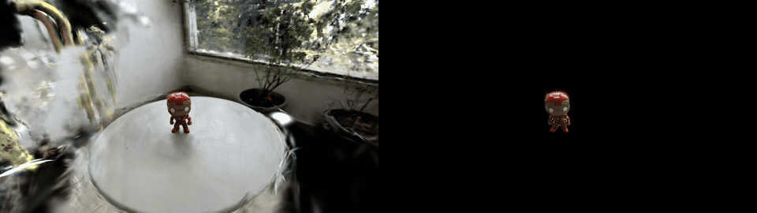
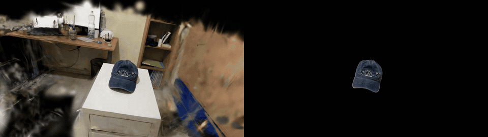

# ObjectGS

### Mask-Guided Object-Centric Gaussian Splatting

ObjectGS is an experimental object-centric 3D Gaussian Splatting
pipeline for reconstructing compact 3D representations of individual
objects from multi-view RGB images and segmentation masks.

The project builds on the original Graphdeco 3D Gaussian Splatting
implementation and modifies both the training objective and
densification behavior for small foreground objects.


## Visual Results

ObjectGS reconstructs the target object rather than the entire scene.
Each comparison uses a synchronized side-by-side animation.

### Iron Man — Multi-view Images

<table>
<tr>
<td align="center"><b>Vanilla 3DGS — 7K</b></td>
<td align="center"><b>ObjectGS — 7K</b></td>
</tr>
<tr>
<td colspan="2" align="center">

</td>
</tr>
<tr>
<td align="center">399,965 Gaussians</td>
<td align="center">6,295 Gaussians</td>
</tr>
</table>

**Result:** 63.5× fewer Gaussians (98.4% reduction).

### Cap — Video Input (54 Frames)

54 frames extracted from a video at 3 FPS, with segmentation
masks propagated using SAM2 Video Tracking.

<table>
<tr>
<td align="center"><b>Vanilla 3DGS — 7K</b></td>
<td align="center"><b>ObjectGS — 7K</b></td>
</tr>
<tr>
<td colspan="2" align="center">

</td>
</tr>
<tr>
<td align="center">175,251 Gaussians</td>
<td align="center">24,312 Gaussians</td>
</tr>
</table>

**Result:** 7.2× fewer Gaussians (86.1% reduction).

### Quantitative Summary

| Metric | Iron Man Vanilla | Iron Man ObjectGS | Cap Vanilla | Cap ObjectGS |
|---|---:|---:|---:|---:|
| Iterations | 7,000 | 7,000 | 7,000 | 7,000 |
| Gaussians | 399,965 | 6,295 | 175,251 | 24,312 |
| PLY size | — | — | 41.45 MB | 5.75 MB |
| Training time | Not measured | Not measured | Not measured | 285.18 s |

The cap baseline used `--eval`, whereas ObjectGS trained on all
registered frames. The training splits therefore differ, so this
is a qualitative comparison rather than a controlled benchmark.

Results are preliminary and cover two captured objects.

## Quick Start

ObjectGS supports two workflows: video input and multi-view images.
Both run segmentation, COLMAP, object-only SfM, and ObjectGS training.

### Installation

    git clone https://github.com/ArielStr/ObjectGS.git
    cd ObjectGS
    bash setup.sh --mode gpu --install-colmap --install-sam2

A CUDA GPU is required for training.
The SAM2 checkpoint is downloaded to `checkpoints/sam2.1_hiera_small.pt`.

### Run from Video

    python scripts/run_pipeline.py --video data/my_object/video.mp4 --point 1150 1320 --fps 3 --sam-checkpoint checkpoints/sam2.1_hiera_small.pt --output outputs/my_video --iterations 7000 --sift-gpu off

The `--point X Y` coordinates must be inside the target object
in the first extracted frame, at its original resolution.
SAM2 Video Tracking propagates the mask through subsequent frames.

### Run from Images

    python scripts/run_pipeline.py --images data/my_object/images --prompts data/my_object/prompts.json --sam-checkpoint checkpoints/sam2.1_hiera_small.pt --output outputs/my_images --iterations 7000 --sift-gpu off

Provide per-image SAM2 box or point prompts in JSON format.
See [Generate masks with SAM2](#generate-masks-with-sam2).

### Outputs

The final model is saved under:

    outputs/my_video/objectgs_7000/point_cloud/iteration_7000/point_cloud.ply

The output directory also contains masks, COLMAP reconstruction,
object-only SfM, prepared scene data, logs, and pipeline summary.
Open the final PLY in [SuperSplat](https://superspl.at/editor).

### Resume

Existing stages are skipped when their outputs pass validation.
Use a fresh output directory when changing inputs or parameters.
The pipeline does not automatically detect configuration changes.
Use `--force` only with a new or empty output directory.

On headless Colab, `--sift-gpu off` avoids COLMAP OpenGL issues.
ObjectGS training still uses CUDA.

## Motivation

Standard 3D Gaussian Splatting is designed for full-scene
reconstruction.

For object-centric reconstruction, we instead want the photometric
objective to focus only on pixels belonging to the target object.

A straightforward masked loss introduces an important side effect:
when the reconstruction error is normalized by the much smaller
foreground area, the screen-space gradients used by the standard 3DGS
densification heuristic become substantially larger.

In our experiments this caused severe over-densification.


## Core idea

ObjectGS separates the scale of the reconstruction objective from the
scale used by the densification heuristic.

For each training view, the object reconstruction term is:

    object_loss =
        masked_photometric_error / foreground_area

An additional outside-mask penalty discourages rendered RGB outside
the object silhouette:

    loss =
        object_loss
        + lambda_outside * outside_loss

For densification only, the accumulated screen-space gradient can be
rescaled using:

    densification_gradient *= mask_fraction

where:

    mask_fraction =
        foreground_pixels / image_pixels

This keeps the reconstruction objective focused on the object while
bringing the densification signal back toward the scale expected by
the original 3DGS heuristic.

The correction can be disabled for ablation experiments.


## Pipeline

ObjectGS supports two input modes that share the same reconstruction
and training stages.

    Multi-view images              Input video
           |                           |
           |                    Frame extraction
           |                           |
    SAM2 image segmentation     SAM2 video tracking
           |                           |
           +------------+--------------+
                        |
                 RGB images + masks
                        |
                  COLMAP SfM
                        |
             Select largest registered
                reconstruction
                        |
                Image undistortion
                        |
             Multi-view mask consistency
                        |
                 Object-only SfM
                        |
                Scene preparation
                        |
                 ObjectGS training
                        |
             Object-centric 3D Gaussians

The COLMAP wrapper selects the reconstruction with the most registered
images and records it in `selected_model.txt`. Downstream stages use
that same reconstruction rather than assuming `sparse/0`.

Object-only SfM retains 3D points based on the consistency of their
multi-view observations with the segmentation masks.

The prepared scene contains undistorted RGB images, aligned binary
masks, camera parameters, and object-only SfM initialization.

ObjectGS then trains using mask-guided photometric supervision,
an outside-mask penalty, and mask-normalized densification.

## Object-only SfM initialization

`scripts/prepare_object_sfm.py` uses the original COLMAP reconstruction
and the object masks to classify sparse Point3D tracks.

For a 3D point `p`, mask consistency is defined as:

    C(p) =
        number of observations inside the object masks
        ------------------------------------------------
        total number of observations of p

A point is retained when:

    C(p) >= consistency_threshold

The default threshold is:

    consistency_threshold = 1.0

so every observation of a retained sparse point must lie inside the
object silhouette.

The selected Point3D IDs are then applied to the undistorted COLMAP
reconstruction, preserving the camera geometry and valid Point2D /
Point3D associations.


## Scene preparation

`scripts/prepare_scene.py` constructs the final ObjectGS training scene.

The RGB images are the COLMAP-undistorted registered images.

Object masks are transformed through the same COLMAP
`image_undistorter` geometry and then converted back to binary masks
using:

    grayscale > 127

This ensures that RGB images, masks, cameras, and sparse initialization
all share the same undistorted coordinate system.


## Training scene format

A prepared scene has the following structure:

    scene/
      images/
        IMG_0001.jpeg
        ...

      masks/
        IMG_0001.png
        ...

      sparse/
        0/
          cameras.bin
          images.bin
          points3D.bin

Masks use the same image stem as their corresponding RGB image.


## Scripts

### Generate masks with SAM2

ObjectGS expects one binary foreground mask per input image. Masks can be
generated with [SAM2](https://github.com/facebookresearch/sam2) using the
provided wrapper.

Install the official SAM2 package:

```bash
git clone https://github.com/facebookresearch/sam2.git
cd sam2
pip install -e .
```

Download a SAM2 checkpoint. The Object 02 experiment uses
`sam2.1_hiera_small.pt` with the corresponding
`configs/sam2.1/sam2.1_hiera_s.yaml` model configuration.

Prompts are supplied as JSON and may be keyed either by image stem or by
the full image filename:

```json
{
  "IMG_5544.jpeg": {
    "box": [1415, 1429, 2067, 1812]
  }
}
```

Box coordinates follow `[x0, y0, x1, y1]`. Point prompts are also
supported by the script.

Generate the masks:

```bash
python scripts/generate_masks_sam2.py \
    --images /path/to/images \
    --output /path/to/masks \
    --prompts /path/to/prompts.json \
    --model-cfg configs/sam2.1/sam2.1_hiera_s.yaml \
    --checkpoint /path/to/sam2.1_hiera_small.pt \
    --device cuda
```

The generated masks are binary PNG files named by image stem. Validate
them before continuing with the reconstruction pipeline.

### Generate video masks with SAM2

ObjectGS supports generating object masks from an ordered sequence
of video frames using SAM2 Video Tracking.

Unlike per-image SAM2 prompting, this workflow requires only one
positive point in the first frame. SAM2 propagates the segmentation
through the remaining frames.

#### Example

    python scripts/generate_masks_sam2_video.py \
      --images /path/to/frames \
      --output /path/to/masks \
      --checkpoint checkpoints/sam2.1_hiera_small.pt \
      --point 1080 1350 \
      --device cuda \
      --precision bf16

The point coordinates are specified in the original first-frame
image resolution.

#### Requirements

- Install SAM2 using `setup.sh --install-sam2`.
- Input frames must be JPEG images with numeric frame ordering.
  Examples: `frame_0000.jpg`, `frame_0001.jpg`.
- Frames must represent a temporally ordered video sequence.
- Use a CUDA GPU for BF16 inference.

The script automatically creates temporary numeric filenames
required by SAM2 without modifying the source images.

#### Output

For each input image, the script creates a binary grayscale PNG:

- Object pixels: 255 (white)
- Background pixels: 0 (black)
- Resolution: identical to the source image
- Filename: `<image_stem>.png`

The generated masks are compatible with ObjectGS scene preparation
and object-only SfM initialization.

#### Validation

    python scripts/validate_masks.py \
      --images /path/to/frames \
      --masks /path/to/masks

Inspect the generated masks before training.

### Validate masks

    python scripts/validate_masks.py \
        --images /path/to/images \
        --masks /path/to/masks

Checks image/mask pairing, resolution, mask format, empty masks, and
foreground statistics.


### Run COLMAP

    python scripts/run_colmap.py \
        --images /path/to/images \
        --workspace /path/to/colmap_workspace

The wrapper performs feature extraction, matching, sparse mapping, and
scene undistortion.


### Prepare object-only SfM

    python scripts/prepare_object_sfm.py \
        --original-model /path/to/sparse/0 \
        --undistorted-model /path/to/undistorted/sparse \
        --masks /path/to/masks \
        --output /path/to/object_sfm

By default, only Point3D tracks with mask consistency `1.0` are kept.


### Prepare the ObjectGS scene

    python scripts/prepare_scene.py \
        --original-model /path/to/sparse/0 \
        --undistorted-images /path/to/undistorted/images \
        --object-model /path/to/object_sfm \
        --masks /path/to/masks \
        --output /path/to/objectgs_scene


### Train ObjectGS

    python scripts/train_objectgs.py \
        --runtime /path/to/patched/gaussian-splatting \
        --scene /path/to/objectgs_scene \
        --output /path/to/output \
        --iterations 7000

The default ObjectGS configuration uses:

    lambda_outside = 1.0
    mask_normalized_densification = enabled


## Reproducibility check

The scene-preparation pipeline was reconstructed and checked against
the original reference experiment.

For the reference object:

    original images       : 39
    registered views      : 36

    full SfM points       : 2,536
    object SfM points     : 1,736

    full observations     : 9,478
    object observations   : 7,006

The object-only SfM preparation reproduced exactly:

    Point3D IDs
    Point3D geometry
    colors
    tracks
    camera parameters
    image poses
    Point2D associations

The complete scene preparation reproduced:

    RGB images            : 36 / 36 byte-identical
    object masks          : 36 / 36 pixel-identical
    differing mask pixels : 0

This provides an end-to-end reproducible path from the original
COLMAP reconstruction and masks to the ObjectGS training scene.


### Clean-runtime reproduction (October 2026)

| Metric | Original | Reproduced |
|---|---:|---:|
| Registered images | 36 | 36 |
| Full SfM points | 2,536 | 2,504 |
| Object SfM points | 1,736 | 1,724 |
| Gaussians after 7K | 5,585 | 5,623 |

The Gaussian count differs by 0.68% from the reference run.
SAM2 box prompts were derived from ground-truth masks.
This is a box-prompt-guided reproduction, not automatic detection.
Similar counts do not prove identical geometry or visual quality.


## Upstream 3DGS

ObjectGS is developed against a pinned version of the original
Graphdeco Gaussian Splatting repository.

See:

    UPSTREAM.md
    objectgs.patch
    setup.sh

for the pinned upstream commit and patch-based setup.

The ObjectGS changes are intentionally kept separate from the full
upstream repository.


## Repository status

ObjectGS is a research prototype for object-centric 3D Gaussian Splatting.

**Implemented:**

- End-to-end pipelines for multi-view images and video input
- SAM2 image segmentation and video mask propagation
- COLMAP reconstruction and largest-component selection
- Multi-view mask-consistency filtering for object-only SfM
- Reproducible undistorted scene preparation
- Mask-guided photometric supervision and outside-mask penalty
- Mask-normalized Gaussian densification
- Patched upstream 3DGS training integration
- Stage validation, resume support, and pipeline logging
- Synchronized visual comparisons against Vanilla 3DGS

**Current limitations and future work:**

- Validate the updated pipeline on a new object from a clean runtime
- Perform controlled Vanilla 3DGS versus ObjectGS comparisons
- Measure reconstruction quality using image and silhouette metrics
- Evaluate robustness across additional objects and capture conditions
- Extend automated testing and reproducibility checks

## Acknowledgements

ObjectGS builds upon the original 3D Gaussian Splatting implementation
by Kerbl et al.

SAM 2 can optionally be used for object-mask generation.

See the upstream projects and repository licensing information before
redistributing or using the software.

### SAM2 checkpoint

When `setup.sh` is run with `--install-sam2`, it automatically downloads the official SAM2.1 Hiera Small checkpoint to `checkpoints/sam2.1_hiera_small.pt`.

The checkpoint is reused on subsequent setup runs and is excluded from Git. Pass its path to the pipeline using `--sam-checkpoint`.
