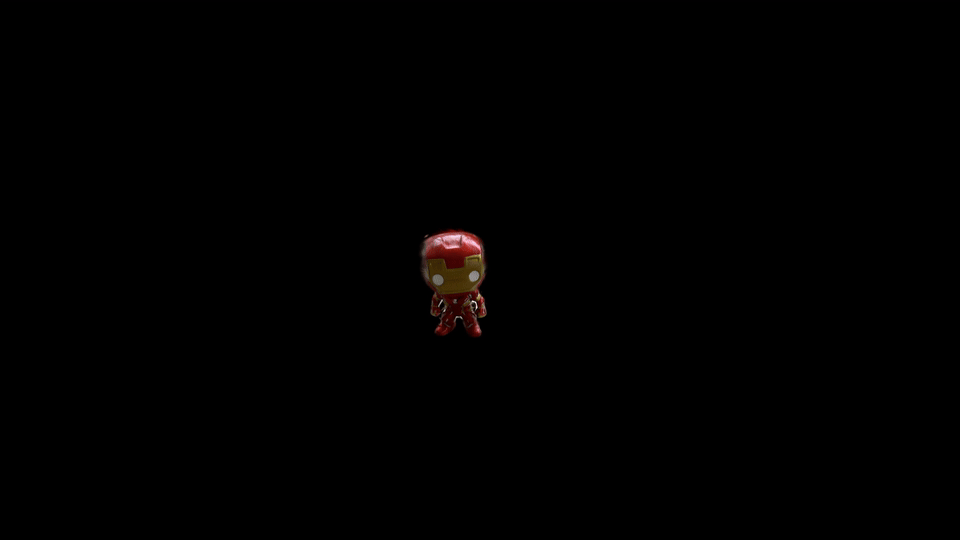

# ObjectGS

### Mask-Guided Object-Centric Gaussian Splatting

ObjectGS is an experimental object-centric 3D Gaussian Splatting
pipeline for reconstructing compact 3D representations of individual
objects from multi-view RGB images and segmentation masks.

The project builds on the original Graphdeco 3D Gaussian Splatting
implementation and modifies both the training objective and
densification behavior for small foreground objects.


## Quick Start

Install ObjectGS:

    git clone https://github.com/ArielStr/ObjectGS.git
    cd ObjectGS
    bash setup.sh --mode gpu --install-colmap --install-sam2

Prepare multi-view RGB images and a JSON file containing
SAM2 box prompts for each image.

Download the matching SAM2 checkpoint separately.

Run the complete pipeline:

    python scripts/run_pipeline.py --images data/my_object/images --prompts data/my_object/prompts.json --sam-checkpoint checkpoints/sam2.1_hiera_small.pt --output outputs/my_object --iterations 7000 --sift-gpu off

The pipeline performs SAM2 segmentation, COLMAP reconstruction,
object-only SfM filtering, scene preparation, and ObjectGS training.

Final model:

    outputs/my_object/objectgs_7000/point_cloud/iteration_7000/point_cloud.ply

### Resume

Existing stages are skipped when their outputs pass basic validation.
Use a fresh output directory when changing inputs or parameters.
The MVP does not track input or configuration changes automatically.
The --force option requires a new or empty output directory.

In headless Colab environments, --sift-gpu off avoids COLMAP
OpenGL context issues. ObjectGS training still uses CUDA.


## Motivation

Standard 3D Gaussian Splatting is designed for full-scene
reconstruction.

For object-centric reconstruction, we instead want the photometric
objective to focus only on pixels belonging to the target object.

A straightforward masked loss introduces an important side effect:
when the reconstruction error is normalized by the much smaller
foreground area, the screen-space gradients used by the standard 3DGS
densification heuristic become substantially larger.

In our experiments this caused severe over-densification.


## Core idea

ObjectGS separates the scale of the reconstruction objective from the
scale used by the densification heuristic.

For each training view, the object reconstruction term is:

    object_loss =
        masked_photometric_error / foreground_area

An additional outside-mask penalty discourages rendered RGB outside
the object silhouette:

    loss =
        object_loss
        + lambda_outside * outside_loss

For densification only, the accumulated screen-space gradient can be
rescaled using:

    densification_gradient *= mask_fraction

where:

    mask_fraction =
        foreground_pixels / image_pixels

This keeps the reconstruction objective focused on the object while
bringing the densification signal back toward the scale expected by
the original 3DGS heuristic.

The correction can be disabled for ablation experiments.


## Visual comparison

We compare ObjectGS with the standard 3D Gaussian Splatting pipeline
on the same multi-view capture.

Both visualizations below use the same camera trajectory.

<table>
<tr>
<td align="center"><b>Standard 3DGS</b></td>
<td align="center"><b>ObjectGS</b></td>
</tr>
<tr>
<td></td>
<td></td>
</tr>
<tr>
<td align="center">399,965 Gaussians</td>
<td align="center">6,295 Gaussians</td>
</tr>
</table>

## Result

On this capture, the standard full-scene 3DGS reconstruction contains
**399,965 Gaussians**, while ObjectGS represents the target object with
**6,295 Gaussians**.

| Method | Gaussians |
|---|---:|
| Standard 3DGS | 399,965 |
| ObjectGS | 6,295 |

This corresponds to approximately **63.5× fewer Gaussians** for the
object-centric representation in this experiment.

These results are preliminary and currently cover a single evaluation
object. Evaluation on additional objects is in progress.

## Pipeline

The repository provides wrappers for the main reconstruction stages:

    Multi-view RGB images
              |
              +---- segmentation ----> object masks
              |
              v
            COLMAP
              |
              v
       full sparse SfM
              |
              v
    multi-view mask consistency
              |
              v
      object-only SfM
              |
              v
       scene preparation
        /            \
       /              \
undistorted RGB   undistorted masks
                         |
                    threshold > 127
       \              /
        \            /
              |
              v
       ObjectGS scene
              |
              v
       ObjectGS training
              |
              v
    compact object Gaussian model

Masks can be produced manually or by an external segmentation model.
SAM 2 mask generation is supported through `scripts/generate_masks_sam2.py`.


## Object-only SfM initialization

`scripts/prepare_object_sfm.py` uses the original COLMAP reconstruction
and the object masks to classify sparse Point3D tracks.

For a 3D point `p`, mask consistency is defined as:

    C(p) =
        number of observations inside the object masks
        ------------------------------------------------
        total number of observations of p

A point is retained when:

    C(p) >= consistency_threshold

The default threshold is:

    consistency_threshold = 1.0

so every observation of a retained sparse point must lie inside the
object silhouette.

The selected Point3D IDs are then applied to the undistorted COLMAP
reconstruction, preserving the camera geometry and valid Point2D /
Point3D associations.


## Scene preparation

`scripts/prepare_scene.py` constructs the final ObjectGS training scene.

The RGB images are the COLMAP-undistorted registered images.

Object masks are transformed through the same COLMAP
`image_undistorter` geometry and then converted back to binary masks
using:

    grayscale > 127

This ensures that RGB images, masks, cameras, and sparse initialization
all share the same undistorted coordinate system.


## Training scene format

A prepared scene has the following structure:

    scene/
      images/
        IMG_0001.jpeg
        ...

      masks/
        IMG_0001.png
        ...

      sparse/
        0/
          cameras.bin
          images.bin
          points3D.bin

Masks use the same image stem as their corresponding RGB image.


## Scripts

### Generate masks with SAM2

ObjectGS expects one binary foreground mask per input image. Masks can be
generated with [SAM2](https://github.com/facebookresearch/sam2) using the
provided wrapper.

Install the official SAM2 package:

```bash
git clone https://github.com/facebookresearch/sam2.git
cd sam2
pip install -e .
```

Download a SAM2 checkpoint. The Object 02 experiment uses
`sam2.1_hiera_small.pt` with the corresponding
`configs/sam2.1/sam2.1_hiera_s.yaml` model configuration.

Prompts are supplied as JSON and may be keyed either by image stem or by
the full image filename:

```json
{
  "IMG_5544.jpeg": {
    "box": [1415, 1429, 2067, 1812]
  }
}
```

Box coordinates follow `[x0, y0, x1, y1]`. Point prompts are also
supported by the script.

Generate the masks:

```bash
python scripts/generate_masks_sam2.py \
    --images /path/to/images \
    --output /path/to/masks \
    --prompts /path/to/prompts.json \
    --model-cfg configs/sam2.1/sam2.1_hiera_s.yaml \
    --checkpoint /path/to/sam2.1_hiera_small.pt \
    --device cuda
```

The generated masks are binary PNG files named by image stem. Validate
them before continuing with the reconstruction pipeline.

### Validate masks

    python scripts/validate_masks.py \
        --images /path/to/images \
        --masks /path/to/masks

Checks image/mask pairing, resolution, mask format, empty masks, and
foreground statistics.


### Run COLMAP

    python scripts/run_colmap.py \
        --images /path/to/images \
        --workspace /path/to/colmap_workspace

The wrapper performs feature extraction, matching, sparse mapping, and
scene undistortion.


### Prepare object-only SfM

    python scripts/prepare_object_sfm.py \
        --original-model /path/to/sparse/0 \
        --undistorted-model /path/to/undistorted/sparse \
        --masks /path/to/masks \
        --output /path/to/object_sfm

By default, only Point3D tracks with mask consistency `1.0` are kept.


### Prepare the ObjectGS scene

    python scripts/prepare_scene.py \
        --original-model /path/to/sparse/0 \
        --undistorted-images /path/to/undistorted/images \
        --object-model /path/to/object_sfm \
        --masks /path/to/masks \
        --output /path/to/objectgs_scene


### Train ObjectGS

    python scripts/train_objectgs.py \
        --runtime /path/to/patched/gaussian-splatting \
        --scene /path/to/objectgs_scene \
        --output /path/to/output \
        --iterations 7000

The default ObjectGS configuration uses:

    lambda_outside = 1.0
    mask_normalized_densification = enabled


## Reproducibility check

The scene-preparation pipeline was reconstructed and checked against
the original reference experiment.

For the reference object:

    original images       : 39
    registered views      : 36

    full SfM points       : 2,536
    object SfM points     : 1,736

    full observations     : 9,478
    object observations   : 7,006

The object-only SfM preparation reproduced exactly:

    Point3D IDs
    Point3D geometry
    colors
    tracks
    camera parameters
    image poses
    Point2D associations

The complete scene preparation reproduced:

    RGB images            : 36 / 36 byte-identical
    object masks          : 36 / 36 pixel-identical
    differing mask pixels : 0

This provides an end-to-end reproducible path from the original
COLMAP reconstruction and masks to the ObjectGS training scene.


### Clean-runtime reproduction (October 2026)

| Metric | Original | Reproduced |
|---|---:|---:|
| Registered images | 36 | 36 |
| Full SfM points | 2,536 | 2,504 |
| Object SfM points | 1,736 | 1,724 |
| Gaussians after 7K | 5,585 | 5,623 |

The Gaussian count differs by 0.68% from the reference run.
SAM2 box prompts were derived from ground-truth masks.
This is a box-prompt-guided reproduction, not automatic detection.
Similar counts do not prove identical geometry or visual quality.


## Upstream 3DGS

ObjectGS is developed against a pinned version of the original
Graphdeco Gaussian Splatting repository.

See:

    UPSTREAM.md
    objectgs.patch
    setup.sh

for the pinned upstream commit and patch-based setup.

The ObjectGS changes are intentionally kept separate from the full
upstream repository.


## Repository status

Research prototype.

Implemented:

- mask validation
- COLMAP pipeline wrapper
- multi-view object-SfM filtering
- reproducible undistorted scene preparation
- object-only photometric training loss
- outside-mask RGB penalty
- mask-normalized densification
- ObjectGS training wrapper
- pinned upstream 3DGS integration

Current work:

- evaluate end-to-end reconstruction on additional objects
- perform controlled ablations
- measure reconstruction quality vs. Gaussian count
- add qualitative renders and comparison figures


## Acknowledgements

ObjectGS builds upon the original 3D Gaussian Splatting implementation
by Kerbl et al.

SAM 2 can optionally be used for object-mask generation.

See the upstream projects and repository licensing information before
redistributing or using the software.

### SAM2 checkpoint

When `setup.sh` is run with `--install-sam2`, it automatically downloads the official SAM2.1 Hiera Small checkpoint to `checkpoints/sam2.1_hiera_small.pt`.

The checkpoint is reused on subsequent setup runs and is excluded from Git. Pass its path to the pipeline using `--sam-checkpoint`.

## SAM2 Video Mask Generation

ObjectGS supports generating object masks from an ordered sequence
of video frames using SAM2 Video Tracking.

Unlike per-image SAM2 prompting, this workflow requires only one
positive point in the first frame. SAM2 propagates the segmentation
through the remaining frames.

### Example

    python scripts/generate_masks_sam2_video.py \
      --images /path/to/frames \
      --output /path/to/masks \
      --checkpoint checkpoints/sam2.1_hiera_small.pt \
      --point 1080 1350 \
      --device cuda \
      --precision bf16

The point coordinates are specified in the original first-frame
image resolution.

### Requirements

- Install SAM2 using `setup.sh --install-sam2`.
- Input frames must be JPEG images with numeric frame ordering.
  Examples: `frame_0000.jpg`, `frame_0001.jpg`.
- Frames must represent a temporally ordered video sequence.
- Use a CUDA GPU for BF16 inference.

The script automatically creates temporary numeric filenames
required by SAM2 without modifying the source images.

### Output

For each input image, the script creates a binary grayscale PNG:

- Object pixels: 255 (white)
- Background pixels: 0 (black)
- Resolution: identical to the source image
- Filename: `<image_stem>.png`

The generated masks are compatible with ObjectGS scene preparation
and object-only SfM initialization.

### Validation

    python scripts/validate_masks.py \
      --images /path/to/frames \
      --masks /path/to/masks

Inspect the generated masks before training.
